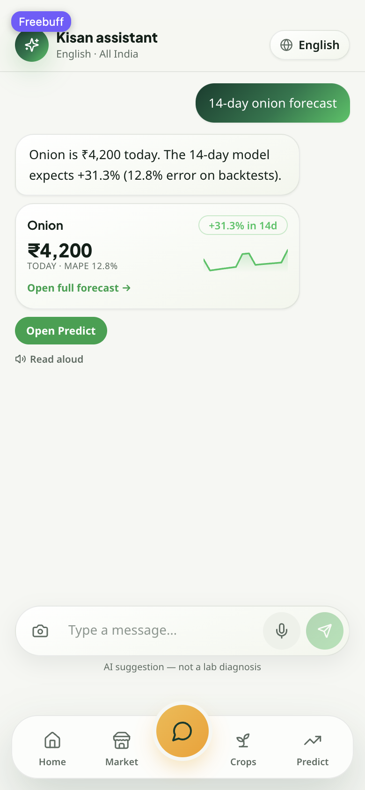

# FarmIntel — crop advisory, mandi prices and price forecasting

A full-stack decision-support app for Indian farmers: what to grow in *your*
district, what your mandi actually paid, where the price is heading, which
fertiliser and rotation to use, and a chat assistant that answers in the
farmer's own language — all backed by real data, with the provenance of every
number shown in the UI.

| Layer | Stack |
| --- | --- |
| Frontend | React 18, TypeScript, Vite, Tailwind CSS, shadcn/ui, Recharts, Supabase (auth/profile) |
| Backend | FastAPI, scikit-learn, XGBoost, pandas, NumPy, SQLite price store |
| ML | Random-forest + XGBoost crop recommender, Holt-Winters price forecast, cosine-similarity fertiliser matcher |
| Data | AGMARKNET (api.data.gov.in daily feed + monthly district analysis), DES district crop/soil data, Open-Meteo weather |
| Languages | 11 Indian languages (en, hi, kn, te, ta, ml, mr, gu, bn, pa, or) |



## Features

- **Crop recommendation** — ranks crops per district using soil (N/P/K/pH),
  climate, the ML model, the district's own cropped-area share and the real
  mandi price, with the evidence for each rank exposed in the UI.
- **Mandi prices** — per-district price cards with live/cached/monthly/MSP
  badges, the mandi that filed the rate, its trading day and the district's
  mandi list. A district page is strictly that district.
- **Price forecasting** — 14-day trajectory, confidence interval from a
  rolling-origin backtest (MAPE), seasonality, festival demand and supply
  shocks, all labelled with the data basis (daily history or monthly averages).
- **Fertiliser and rotation advice** — dataset-driven recommendations plus
  nutrient-gap planning for the next season.
- **Multilingual assistant** — grounded answers with cards and actions,
  rate-limited, key stays server-side.
- **Works offline-ish** — the SQLite store ships with the repo, so market,
  forecast and advisory screens work before any ingest is run.

## Repository layout

```
backend/                 FastAPI app and data pipeline
  main.py                HTTP API (see endpoints below)
  serve.py               production-ish entry point used by start.sh
  config.py              single env reader for every secret/setting
  mandi_prices.py        price resolution: district feed -> store -> monthly -> MSP
  price_store.py         SQLite store (daily rows + monthly averages)
  price_forecast.py      Holt-Winters forecast, backtest, confidence bands
  price_factors.py       season/weather/festival/supply context
  district_data.py       DES district crop share + soil + crop master
  crop_info.py           agronomy facts per crop
  chat.py                assistant (provider-agnostic, grounded on real data)
  daily_ingest.py        daily AGMARKNET snapshot into the store
  agmarknet_monthly.py   monthly district average backfill
  models/                trained crop models + lookup tables (shipped)
  data/                  crop master, reference JSON, soil dataset (shipped)
  tests/                 system/contract/regression suite (249+ tests)

src/                     React app
  pages/                 Home, Market, Predict, Recommendations, Rotation,
                         Fertiliser, Chat, Profile, Crop detail
  lib/                   typed API clients (marketApi, priceApi, api, env, profile)
  components/            design system (ui-kit) and feature cards

supabase/migrations/     SQL schema + RLS for profiles, listings, prices
.github/workflows/       daily mandi ingest job
screenshots/             UI reference shots
```

## Quick start

Prerequisites: **Node 18+**, **Python 3.11+** (developed on 3.14), Git.

```bash
git clone https://github.com/karthik2429/Farm_intel.git
cd Farm_intel

# 1. Backend
python3 -m venv .venv
.venv/bin/pip install -r backend/requirements.txt openpyxl
cp .env.example .env          # fill in DATA_GOV_API_KEY at minimum

# 2. Frontend
npm install
cp .env.local.example .env.local

# 3. Run both
./start.sh                    # backend :8000, frontend :5173
./start.sh status             # what is running
./start.sh stop               # stop only what start.sh started
```

Open <http://localhost:5173>. Ports come from `BACKEND_PORT` / `FRONTEND_PORT`;
`start.sh` never kills a port it does not own — it picks the next free one.

Manual alternative:

```bash
cd backend && ../.venv/bin/python -m uvicorn main:app --port 8000
npm run dev -- --port 5173
```

## Configuration

Backend env (`Farm_intel/.env`, template: [`.env.example`](.env.example)).
Everything is optional except the data key — the app degrades honestly instead
of inventing numbers.

| Key | Purpose |
| --- | --- |
| `DATA_GOV_API_KEY` | AGMARKNET live feed (api.data.gov.in) — free registration |
| `MANDI_DB_PATH` | Override the SQLite store location |
| `BACKEND_PORT`, `CORS_ORIGINS`, `APP_ENV` | Server basics |
| `GEMINI_API_KEY` / `GROQ_API_KEY` / `OPENROUTER_API_KEY` / `OLLAMA_BASE_URL` | Assistant backend (any one; first available wins) |
| `SUPABASE_URL`, `SUPABASE_SERVICE_KEY` | Optional mirror of prices to Supabase (CI ingest) |
| `OPEN_METEO_BASE_URL`, `NOMINATIM_*` | Weather/geocoding endpoints |

Frontend env (`.env.local`, template: [`.env.local.example`](.env.local.example)):

| Key | Purpose |
| --- | --- |
| `VITE_API_BASE_URL` | FastAPI origin (default `http://127.0.0.1:8000`) |
| `VITE_SUPABASE_URL`, `VITE_SUPABASE_ANON_KEY` | Sign-in and profile (optional; the app runs signed-out too) |
| `VITE_DEFAULT_LANGUAGE`, `VITE_SPEECH_PROVIDER` | UI language, voice provider |
| `VITE_MAP_TILE_URL`, `VITE_REVERSE_GEOCODE_URL` | Map tiles, reverse geocoding |

> Secrets live only in `.env` / `.env.local`, which are git-ignored. Never put a
> key in `VITE_*` — that ships to the browser.

## Data and models shipped with the repo

| Path | Contents |
| --- | --- |
| `backend/mandi_price_store.db` | ~42k real daily mandi rows (2024→today) and ~72k published district monthly averages |
| `backend/mandi_price_history.csv` | Bundled district price snapshot used by the generator/regression tests |
| `backend/FarmIntel_crop_master_v3_FIXED.xlsx` | Crop master: seasons, duration, yield, NPK, water needs |
| `backend/data/soil_with_coordinates.csv` | DES 2024-25 district soil test data + coordinates |
| `backend/data/agmarknet_ref.json` | AGMARKNET commodity/state reference |
| `backend/fertilizer_recommendation_dataset.csv` | Fertiliser recommendation training data |
| `backend/models/`, `backend/hybrid_crop_model/`, `backend/price_predictor/` | Trained crop models, encoders, district maps, price engine model |

Nothing here is synthetic: rows come from AGMARKNET (live feed, published
monthly analysis) or the DES/crop-master datasets. Where a number is missing the
UI shows `--` with the reason instead of a guess; MSP is always badged as a
government reference price, never as a mandi trade.

### Refreshing the data

```bash
python backend/daily_ingest.py              # today's AGMARKNET snapshot
python backend/daily_ingest.py --status     # coverage report
python backend/agmarknet_monthly.py --states Karnataka --commodities major --years 2026
python backend/agmarknet_monthly.py --states all --commodities major --dry-run
```

`.github/workflows/daily-mandi-ingest.yml` runs the daily snapshot on a schedule
and mirrors the newest rows into Supabase when the repo secrets
(`DATA_GOV_API_KEY`, `SUPABASE_URL`, `SUPABASE_SERVICE_KEY`) are configured.

## API

Base URL `http://127.0.0.1:8000` — interactive docs at `/docs`.

| Method | Path | What it returns |
| --- | --- | --- |
| GET | `/health` | Model, price engine and data readiness |
| GET | `/config/status` | Which integrations are configured (never the values) |
| POST | `/predict` | Crop ranking for soil + location |
| POST | `/rotation/suggestions`, `/rotation/plan` | Rotation options and nutrient plan |
| POST | `/fertilizer/recommend` | Fertiliser matches + top-up |
| POST | `/chat` | Assistant reply, cards and actions |
| GET | `/market/price` | One crop's price with source, date, badge, scope |
| GET | `/market/history` | Daily/monthly trend for the chart |
| GET | `/market/status`, `/market/coverage` | Store coverage and feed health |
| GET | `/commodities` | Scoped crop catalogue (`strict=1` = one district only) |
| GET | `/markets` | Mandis reporting in a district |
| GET | `/predict/14day`, `/predict/trajectory`, `/predict/single` | Forecasts |
| GET | `/predict/factors` | Season/weather/festival/supply factors |
| GET | `/crop/info` | Agronomy metadata for a crop list |
| GET | `/weather` | Current weather for a location |

### District scoping

Mandi data is keyed by district. The app ships official district names
(`Davanagere`) while AGMARKNET files older spellings (`Davangere`), so the
backend resolves every district to the spelling the data actually uses
(alias table → store spelling → guarded near-identical match). A district page
then shows only that district's crops, mandis and trading day; when the live
feed cannot be reached the last stored snapshot for the *same* district is
served and labelled as cached.

## Tests

```bash
# backend: API contracts, data consistency, forecast accuracy, multilingual chat
python -m pytest backend/tests -q            # 249 passed, 2 xfailed

# frontend: vitest
npm test
```

The suite blocks outbound HTTP by default, so a pass means the API degrades
honestly when a provider is down. Live-network tests are opt-in:
`python -m pytest backend/tests --live -m live`.

## Deployment notes

- Frontend: `npm run build` → `dist/` (static, any host).
- Backend: any Python host running `uvicorn main:app`; the SQLite store is
  local, so mount a persistent volume if you want the history to grow.
- Supabase migrations in `supabase/migrations/` cover profiles, marketplace
  listings, mandi prices and the monthly refresh job; apply them once in the
  Supabase SQL editor.

## Troubleshooting

| Symptom | Fix |
| --- | --- |
| Blank market page | Backend not on `VITE_API_BASE_URL`, or `/health` shows the price engine failed to load |
| Every card says "cached" | Live feed unreachable or `DATA_GOV_API_KEY` missing — stored rows are served with their dates |
| `Port 8000 in use` | `./start.sh` picks the next free port; or set `BACKEND_PORT` |
| Models fail to load | Reinstall `backend/requirements.txt`; model pickles need scikit-learn ≥ 1.3 |
| Crop master / soil data missing | They ship in `backend/` and `backend/data/`; check the paths in `district_data.py` |

## License

Academic capstone project. Datasets belong to their publishers (AGMARKNET /
Directorate of Economics and Statistics); check their terms before
redistributing or using commercially.
